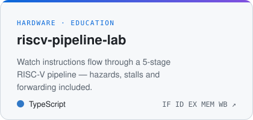
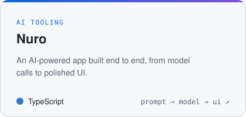
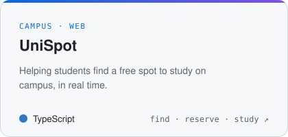
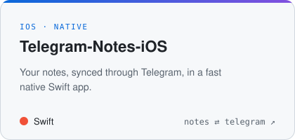

<a href="https://parsaabbasian.com"><picture><source media="(prefers-color-scheme: dark)" srcset="assets/header-dark.svg"/></picture></a>

 

### `> whoami`

I'm a Computer Engineering student at **York University** in Toronto 🇨🇦. I like working across the whole stack, from **CPU pipelines** at the bottom to **fast web apps** and **native iOS** at the top.

- 🔧 Building **riscv-pipeline-lab**, **Nuro** and **UniSpot**
- 🧠 Interested in computer architecture, AI tooling, web performance and iOS
- 💬 Ask me about RISC‑V, TypeScript or Swift

### `> ls ~/projects --featured`

<a href="https://github.com/parsaabbasian/riscv-pipeline-lab"><picture><source media="(prefers-color-scheme: dark)" srcset="assets/riscv-pipeline-lab-dark.svg"/></picture></a>
<a href="https://github.com/parsaabbasian/Nuro"><picture><source media="(prefers-color-scheme: dark)" srcset="assets/nuro-dark.svg"/></picture></a>

<a href="https://github.com/parsaabbasian/UniSpot"><picture><source media="(prefers-color-scheme: dark)" srcset="assets/unispot-dark.svg"/></picture></a>
<a href="https://github.com/parsaabbasian/Telegram-Notes-iOS"><picture><source media="(prefers-color-scheme: dark)" srcset="assets/telegram-notes-ios-dark.svg"/></picture></a>

### `> cat stack.txt`

   
  

### `> git log --graph`

  <picture>
    <source media="(prefers-color-scheme: dark)" srcset="https://raw.githubusercontent.com/parsaabbasian/parsaabbasian/output/snake-dark.svg" />
    
  </picture>

<a href="https://parsaabbasian.com">parsaabbasian.com</a>

